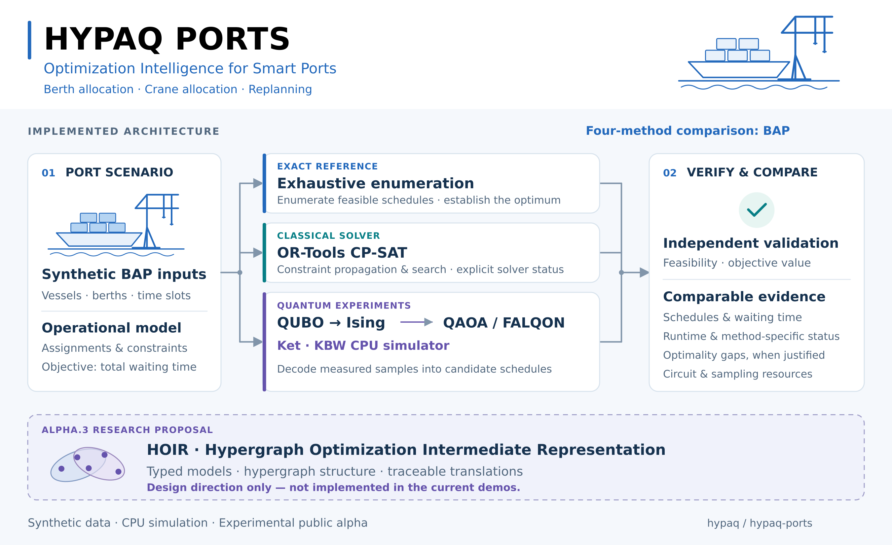

# HYPAQ Ports

**Optimization Intelligence for Smart Ports — AI-First, Quantum-Ready.**



HYPAQ Ports is an open laboratory for learning, modeling, and evaluating optimization approaches for port operations. It connects operational decisions with mathematical models, classical solvers, and quantum optimization experiments using Python and the Ket programming platform.

The project starts with small, explainable exercises and synthetic data. Its intended evolution is a reproducible collection of problem instances, formulations, validation tools, and benchmarks that researchers, students, developers, and industry practitioners can explore and extend.

> **Project status: experimental public alpha.** The published [v0.1.0-alpha.1](https://github.com/hypaq/hypaq-ports/releases/tag/v0.1.0-alpha.1) contains the original classical and quantum demonstrations. On `main`, an additional [BAP CP-SAT scenario](scenarios/bap_cpsat/README.md) is available alongside those examples, with its own notebook, tests, inputs, and live comparisons against enumeration and Ket/KBW QAOA/FALQON. CP-SAT is not part of the alpha.1 source snapshot. AI assistance, quantum hardware execution, and terminal integration remain planned work.

## Why port optimization?

Port operations involve interconnected decisions about vessel arrivals, berth availability, equipment allocation, and service schedules. An arrival delay or unavailable resource can affect waiting times, resource utilization, and the stability of an existing plan.

HYPAQ Ports explores how these decisions can be represented explicitly, solved, validated, and explained. The initial exercises focus on understanding the relationship between the operational problem, the mathematical formulation, and the behavior of different solution methods.

## AI-First, Quantum-Ready

| Principle | Current implementation and planned work |
| --- | --- |
| **AI-First** | Planned: assist with scenario descriptions, structured inputs, and interpretations grounded in verified results. No AI assistant is included in this release. |
| **Optimization Intelligence** | Explicit objectives and constraints, independent feasibility checks, exact classical references, and recorded experimental metrics. |
| **Quantum-Ready** | BAP QUBO/Ising formulation and QAOA/FALQON circuits executed through Ket on the KBW CPU simulator. |
| **Port-oriented** | Express problems and results in terms of vessels, berths, cranes, service demand, and operational schedules. |

The planned AI workflow will use validated input schemas and predefined modeling functions. Solvers will compute candidate solutions, independent checks will evaluate feasibility, and explanations will be grounded in those outputs. AI-generated interpretations will not constitute mathematical proofs of feasibility or optimality.

Quantum experiments use **Ket with the KBW simulator**, running on classical hardware. These experiments support education and evaluation; they do not establish quantum advantage or production readiness.

## The first three exercises

| Exercise | Operational question | Implemented scope | Available output |
| --- | --- | --- | --- |
| **01 — Berth Allocation** | Where and when should each vessel be served? | Discrete one-slot BAP; exact enumeration; optional OR-Tools CP-SAT scenario on `main`; QUBO/Ising; Ket/KBW QAOA and FALQON. | Schedules, waiting-time metrics, quantum distributions, comparison reports, and quantum experiment plots. |
| **02 — Quay Crane Allocation** | How should available cranes be assigned to vessels? | Independent classical enumeration with fixed productivity, demand, and availability. | Crane assignments, demand coverage, and active crane-slot metrics. No crane QUBO or quantum execution yet. |
| **03 — Disruption and Replanning** | How should a schedule change after a vessel arrival delay? | Classical offline BAP replanning after an arrival delay, with an optional stability penalty. | Original-plan feasibility, waiting-time metrics, and assignment-change comparisons. No quantum replanning yet. |

### Exercise 01 — Berth Allocation

**Goal:** assign vessels to compatible berths and service windows while minimizing total waiting time.

The original illustrative instance uses two vessels, two berths, and two time slots, with one-slot service durations and explicit compatibility assumptions. Its full vessel/berth/slot encoding uses eight binary variables and eight qubits. The additional [positive-waiting instance](scenarios/bap_cpsat/data/berth_waiting_v1.json) on `main` uses two vessels, one berth, and three slots, with six encoded qubits and an optimum of one waiting slot. Broader instance families remain planned.

The exercise guides users through:

1. Defining arrival times, berth availability, compatibility, and service duration.
2. Representing assignment decisions with binary variables.
3. Enforcing one assignment per vessel and preventing berth conflicts.
4. Establishing an exact classical reference using exhaustive enumeration and comparing it with the implemented [OR-Tools CP-SAT scenario](scenarios/bap_cpsat/README.md) on the same base BAP inputs. The original classical notebook remains unchanged.
5. Building a QUBO and checking that its penalties represent the intended constraints.
6. Mapping the QUBO to an Ising cost Hamiltonian.
7. Running QAOA and FALQON with Ket/KBW in the quantum notebooks and validating decoded samples.

**Available notebooks:** [classical BAP](notebooks/01_berth_allocation.ipynb), [QAOA](notebooks/quantum/01_berth_allocation_qaoa_ket.ipynb), [FALQON](notebooks/quantum/02_berth_allocation_falqon_ket.ipynb), and [comparison](notebooks/quantum/03_berth_allocation_comparison.ipynb). Quantum notebooks include experiment plots; an operational berth occupancy timeline remains planned.

**Additional notebook on `main`:** [BAP CP-SAT and enumeration](scenarios/bap_cpsat/01_bap_cpsat.ipynb). The [scenario directory](scenarios/bap_cpsat/) also contains an optional live four-method comparison runner. These additions preserve the six original classical/quantum notebooks and their saved computational outputs.

**Scope:** an educational discrete BAP. Navigation-channel coordination, tides, draft restrictions, and detailed terminal operating rules are outside the first version.

### Exercise 02 — Quay Crane Allocation

**Goal:** allocate limited crane capacity to vessel service demand over a short planning horizon.

The supplied illustrative instance uses two vessels, two cranes, and two periods. Both vessels are available in every period. Crane allocation runs independently of Exercise 01 and is not coupled to its berth schedule.

The exercise guides users through:

1. Specifying service demand, crane availability, and simplified productivity.
2. Enforcing that a crane cannot serve multiple vessels simultaneously.
3. Enumerating valid crane assignments, including idle cranes.
4. Minimizing unmet work first, then active crane-slots, with independent capacity checks.
5. Reviewing demand coverage and resource usage. A crane QUBO and quantum experiments remain planned.

**Available notebook:** [classical crane allocation](notebooks/02_quay_crane_allocation.ipynb). A crane-to-vessel allocation timeline remains planned.

**Scope:** simplified quay crane allocation. Crane travel, interference, non-crossing constraints, and detailed task sequencing are outside the first version. This exercise does not represent a complete Quay Crane Scheduling Problem (QCSP).

### Exercise 03 — Disruption and Replanning

**Goal:** understand the trade-off between improving operational performance and preserving an existing schedule after a disruption.

This exercise reuses the berth allocation model and introduces a controlled vessel arrival delay. Berth closures are supported by BAP input data, but an outage-specific replanning notebook scenario is not included.

Users compare three responses:

| Response | Decision rule |
| --- | --- |
| **Evaluate the original plan** | Check whether it remains feasible under the changed conditions and measure its performance when feasible. |
| **Reoptimize the schedule** | Enumerate a new plan for the updated scenario. This offline example starts before service; no assignments are frozen. |
| **Limit schedule changes** | Penalize reassignment or time changes while optimizing the updated plan. |

The implementation uses explicit scenario rules and exact classical references. Quantum replanning is not implemented. A later AI assistant may translate a request such as “Vessel A arrives two hours late” into a structured scenario update for review and execution.

**Available notebook:** [disruption and replanning](notebooks/03_disruption_and_replanning.ipynb), with original and revised schedules and computed metrics. Graphical schedule timelines remain planned.

**Scope:** controlled, offline scenario analysis. Live terminal integration and autonomous operational decisions are outside the initial scope.

## A common experimental workflow

The project uses the following workflow; QUBO/Ising validation and quantum execution currently apply to BAP only:

1. **Describe** the operational decision, assumptions, units, and input data.
2. **Model** the objective and constraints explicitly.
3. **Solve classically** to obtain a reference and record the solver status.
4. **Validate the formulation**, including QUBO penalty behavior on small instances.
5. **Experiment quantumly**, when applicable, using Ket/KBW.
6. **Validate and compare** decoded solutions using the original operational constraints.
7. **Explain** the result, trade-offs, and limitations.

For the supplied BAP instance, exhaustive checks verify the QUBO/Ising energy mapping over all 256 bitstrings, and tests check optimal feasible solutions under the stated penalty assumptions. Reports distinguish the operational objective from penalized QUBO energy, retaining the constant offset in Hamiltonian comparisons.

## Evaluation and reproducibility

The published classical and quantum reports record the following where applicable:

- Instance identifier, data provenance, assumptions, and units.
- Solver status, best feasible objective, and reference optimum when known.
- Constraint violations and the fraction of feasible sampled solutions.
- Empirical frequency of obtaining an optimal solution, when an optimum is known.
- Number of binary variables, qubits, algorithm layers, and circuit depth where available.
- Penalty weights, parameter initialization, random seeds, and sampling settings.
- End-to-end runtime, with classical parameter optimization and simulation costs identified.
- Dependency versions and execution environment.

An optimum will only be reported when established by exhaustive evaluation or an appropriate solver certificate/status. A feasible solution will not be labeled optimal without supporting evidence. Cross-method runtime comparisons will state the execution conditions and measurement boundaries.

## Repository organization

These directories and assets are available on `main`; the CP-SAT scenario was added after the original alpha.1 snapshot:

| Path | Available content |
| --- | --- |
| `notebooks/` | Three executable classical exercises and [local/Colab setup](notebooks/README.md). |
| `notebooks/quantum/` | Three BAP notebooks: QAOA, FALQON, and comparison. |
| `src/` | Exact classical enumeration, the optional base-BAP CP-SAT adapter, QUBO/Ising, validation, reporting, and the Ket quantum adapter. |
| `data/synthetic/` | Three documented handcrafted instances. No instance generator is included yet. |
| `results/` | Classical reference outputs and regeneration script. |
| `results/quantum/` | BAP experiment configuration, simulator reports, CSV summary, and regeneration script. |
| [`scenarios/bap_cpsat/`](scenarios/bap_cpsat/README.md) | Additional CP-SAT demo and notebook, optional dependencies, one additional BAP input, separate JSON/CSV comparisons, and 22 scenario tests. |
| `tests/` | Ten classical behavioral checks and ten quantum integration checks. |
| `docs/` | Model assumptions, execution guidance, quantum methodology, and a recorded validation report. |

## Getting started

Clone the repository and run commands from its root:

```bash
git clone https://github.com/hypaq/hypaq-ports.git
cd hypaq-ports
```

### Classical exercises — Python standard library

Use Python 3.10+; no OR-Tools or Ket installation is needed for these commands:

```bash
python -m unittest discover -s tests -p "test_reference.py" -v
python results/generate_reference.py
```

Open the three classical notebooks with Jupyter or follow the [Colab instructions](notebooks/README.md). Jupyter is a separate notebook interface; it is not required by the reference script. See [START_HERE.md](START_HERE.md).

### Additional BAP CP-SAT scenario — optional OR-Tools

This scenario is available on `main` and is documented in [scenarios/bap_cpsat/README.md](scenarios/bap_cpsat/README.md). It reuses the published CP-SAT adapter and shared operational validator without changing the original classical or quantum demos. Use Python 3.11+ and preferably a separate virtual environment:

```bash
python -m pip install -r scenarios/bap_cpsat/requirements.txt
python scenarios/bap_cpsat/run_demo.py
python -m unittest discover -s scenarios/bap_cpsat/tests -v
python scenarios/bap_cpsat/compare.py --output-prefix scenarios/bap_cpsat/results/my_classical_run
```

These commands require OR-Tools but do not require Ket. To include the existing QAOA and FALQON methods, install the quantum requirements in that optional environment and run:

```bash
python -m pip install -r requirements-quantum.txt
python scenarios/bap_cpsat/compare.py --include-quantum --output-prefix scenarios/bap_cpsat/results/my_four_method_run
```

The comparison executes each method on the same input. New reports stay inside `scenarios/bap_cpsat/`, separately from historical results. CP-SAT distinguishes optimal, feasible, infeasible, inconclusive, and invalid-model outcomes; quantum results remain heuristic even when a sampled solution matches the known optimum. For the positive-waiting case, notebook setup, and recorded results, follow the [scenario guide](scenarios/bap_cpsat/README.md) and [validation record](scenarios/bap_cpsat/VALIDATION.md).

### Quantum BAP experiments — Ket/KBW

Use Python 3.11+ for the pinned dependencies; the recorded environment is Python 3.12.14 on Linux x86_64. A separate virtual environment is recommended. Wheel availability depends on the operating system, architecture, and Python version.

```bash
python -m pip install -r requirements-quantum.txt
python -m unittest discover -s tests -v
python results/quantum/run_berth_comparison.py
```

The original test suite in `tests/` contains 20 tests and imports Ket and NumPy. The 22 additional CP-SAT scenario tests are run separately using the command above; with both dependency sets installed, the two commands cover 42 tests. Without quantum dependencies, use the filtered original classical test command and, if OR-Tools is installed, the scenario tests. The notebooks require a separate Jupyter interface, for example `python -m pip install jupyterlab`. Full external Jupyter/Colab execution was not validated in the recorded build environment; see the original [quantum validation record](docs/quantum/VALIDATION.md) and the additional [CP-SAT scenario validation record](scenarios/bap_cpsat/VALIDATION.md).

See [QUANTUM_START_HERE.md](QUANTUM_START_HERE.md), the [quantum notebook guide](notebooks/quantum/README.md), [methodology](docs/quantum/README.md), and [recorded CSV results](results/quantum/berth_comparison_summary.csv).

### Interpreting the quantum results

The original eight-qubit BAP has an exact optimum of zero waiting slots. Both quantum methods found samples matching that optimum in the recorded run; their overall distributions also contain infeasible states. This does not certify heuristic optimality on other instances.

QAOA optimization and FALQON feedback use exact simulated state-vector expectations. Default final counts use seeded classical sampling from a KBW state snapshot; optional native KBW sampling is also supported. The algorithms use different resource budgets. Neither the original experiment nor the additional two-instance comparisons establish quantum speedup, general algorithm superiority, or industrial readiness.

### Planned extensions

- Extend the implemented base-BAP CP-SAT adapter to richer operational models after validating their assumptions and constraints.
- More BAP instances and repeated experiments with explicit resource budgets.
- Crane QUBO/Ising formulations and quantum replanning after validation.
- Operational schedule timelines, AI-assisted scenario preparation, and authorized partner-data studies.
- Additional quantum backends and hardware evaluation; this alpha currently executes on the KBW CPU simulator.

The current release is an experimental application laboratory, with simplified synthetic data and no live terminal integration. Updating documentation on `main` does not change the source snapshot attached to the existing release tag.

## Contributing

Contributions are welcome in problem modeling, synthetic instances, independent validation, visualization, documentation, and reproducible experiments.

Please open an issue to describe a proposed change before undertaking substantial work. For bug reports, include the relevant instance, environment, configuration, expected behavior, and observed result.

Use only material you are authorized to share. Synthetic or openly licensed data with documented provenance is preferred for public examples. Operational data supplied by partners requires explicit authorization for publication.

## About HYPAQ

HYPAQ develops Optimization Intelligence with an **AI-First, Quantum-Ready** approach. HYPAQ Ports is its public application laboratory for port-related optimization, complementing research in distributed quantum computing and network-sensitive assessment of quantum workloads.

Related public research repositories:

- [HYPAQ DQC](https://github.com/hypaq/hypaq-dqc) — hypergraph partitioning for static and adaptive quantum circuits.
- [HYPAQ DVS](https://github.com/hypaq/hypaq-dvs) — Distributed Viability Score and related research materials.

## Technology references

- [Ket Quantum Programming](https://quantumket.org/) — Python-based quantum programming and the KBW simulator.
- [Ket Programming Guide](https://quantumket.org/guide/index.html) — processes, Hamiltonians, and quantum algorithm examples.
- [OR-Tools CP-SAT](https://developers.google.com/optimization/cp/cp_solver) — solver used by the implemented optional [BAP CP-SAT scenario](scenarios/bap_cpsat/README.md) on `main`. Its optional installation requirements are listed in `scenarios/bap_cpsat/requirements.txt`; the original alpha.1 source snapshot does not include this adapter.

## License

Unless explicitly stated otherwise, repository content is licensed under the **[Apache License 2.0](LICENSE)**. Third-party materials and dependencies retain their respective licenses. Any separately licensed datasets will identify their terms explicitly.

The software license does not grant general permission to use HYPAQ trademarks or imply endorsement by HYPAQ or by the developers of referenced technologies.
